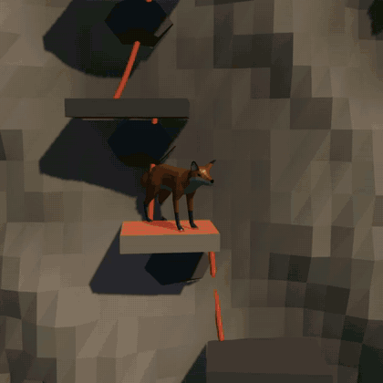

# Timescaler

  

A local-storage-only, installable browser game that teaches telling time and working with
calendars by climbing ten mountain peaks.

**🚧 Work in progress.** The question engine, the ten peaks, the climb rules and local-storage
profiles are built and unit-tested. The game is played in a three.js world: your chosen forest animal
hops from ledge to ledge up a cliff as you answer, slips on a miss, tumbles if you miss too often,
and dances on the summit flag when you make it. The live site may lag the `main` branch.

**Live:** <https://turtlemonvh.github.io/timescaler/>

**Trailer** (30 seconds, with sound):

https://github.com/user-attachments/assets/d0423b43-cade-4d29-bbb4-f33eb37809d0

The GIF, the trailer and the intro screen's video are all filmed from the real game; see
[`trailer/`](./trailer/README.md) to re-shoot them after the scenes change.

## Setup

See [CONTRIBUTING.md](./CONTRIBUTING.md).

## Design

See [docs/superpowers/specs/2026-08-08-summit-clock-design.md](./docs/superpowers/specs/2026-08-08-summit-clock-design.md)
for the original design — game mechanics, the question engine, and the milestone roadmap. Its
presentation (pixel art and pixel fonts) was replaced by the three.js climb in #112; see
[docs/superpowers/specs/2026-10-11-3d-climb-design.md](./docs/superpowers/specs/2026-10-11-3d-climb-design.md)
for the current scene, art direction and file layout.
[docs/superpowers/plans/](./docs/superpowers/plans/) holds the implementation plan for each
milestone, and tracks which are done.

## Stack

TypeScript, Vite, React, three.js (via react-three-fiber), Vitest, Playwright, pnpm. Installable
as a PWA; no backend, no accounts — all progress is local-storage only. Animal models are CC0 from
Quaternius (see `public/models/CREDITS.md`). Coins and trophies are recomputed from the saved
climb log (`src/engine/rewards.ts`), so profiles migrated from save v1 or v2, which have no climb
log, start at 0 coins even with peaks already cleared.

## License

[MIT](./LICENSE)
